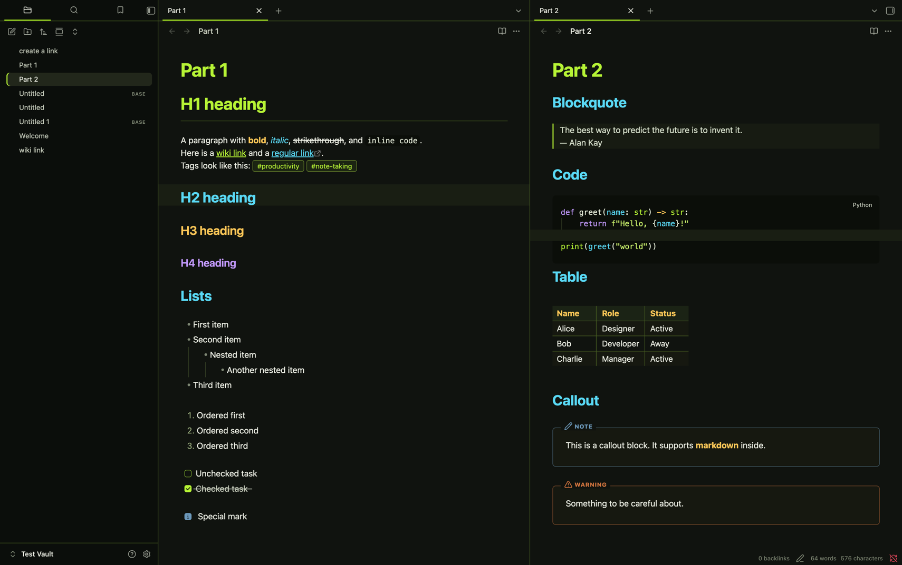
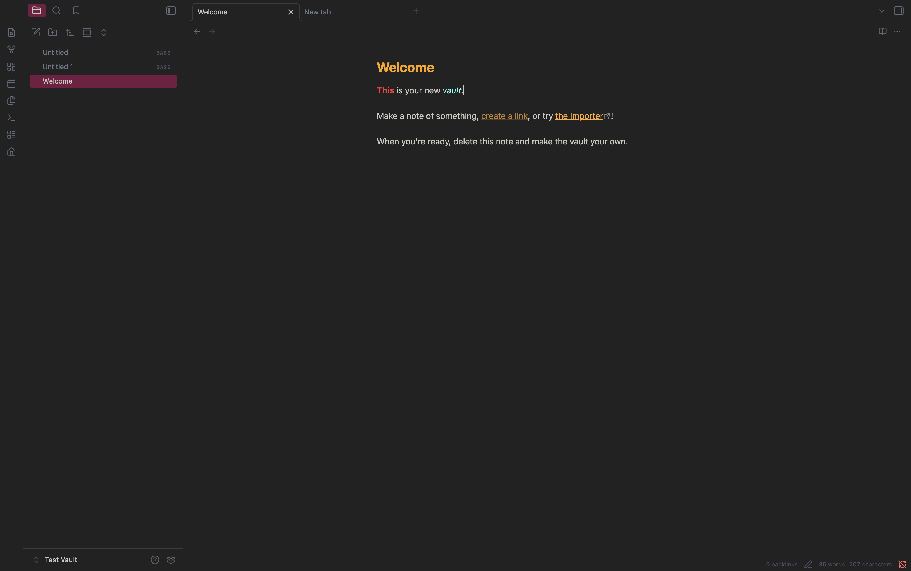
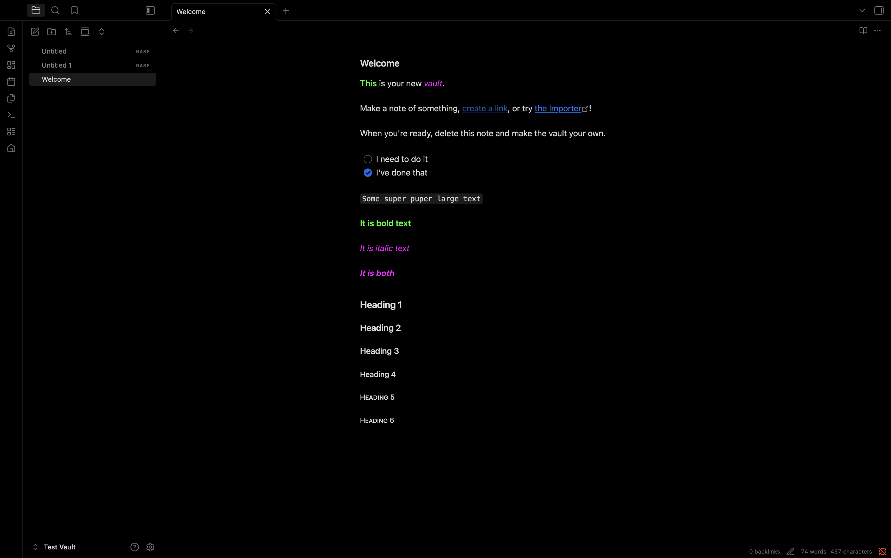
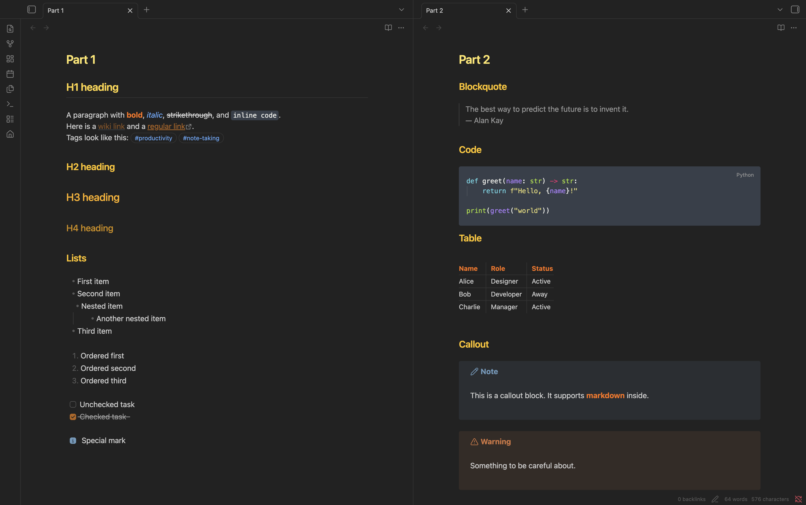

# Obsidian Themes

A collection of color presets for [Minimal Theme](https://github.com/kepano/obsidian-minimal) applied via the [Style Settings](https://github.com/mgmeyers/obsidian-style-settings) plugin.

## Themes

| Theme | Preview |
|-------|---------|
| [Midnight Lime](themes/midnight-lime/) |  |
| [Dark Pink](themes/dark-pink/) |  |
| [Black Blue](themes/black-blue/) |  |
| [Dark Amber](themes/dark-amber/) |  |

## Installation

1. Install **Minimal Theme** in Obsidian (Settings → Appearance → Themes)
2. Install **Minimal Theme Settings** plugin
3. Install **Style Settings** plugin
4. Open **Style Settings** → click **Import** → paste the contents of the theme's `style-settings.json`
5. Apply the additional settings listed in the theme's README (accent color, color scheme, etc.)

## Customization

All themes are starting points — feel free to tweak them to your taste. Open **Minimal Theme Settings** or **Style Settings** (both appear as tabs at the bottom of Obsidian's Settings) to adjust colors, typography, and layout on the fly.

## Contributing

To add your own theme:

1. Fork this repo
2. Create a folder `themes/your-theme-name/` using kebab-case (e.g. `midnight-purple`)
3. Export your Style Settings config: **Style Settings → Export** → copy the JSON
4. Save it as `themes/your-theme-name/style-settings.json`
5. Create `themes/your-theme-name/README.md` with:
   - A short description
   - A settings table (accent color, color scheme, and any other required settings)
   - A screenshot — ideally taken with [`screenshot-template.md`](screenshot-template.md) open in Obsidian, so all previews show comparable content
6. Add a row to the **Themes** table in this README
7. Open a Pull Request

**Naming rules for the folder:**
- Pattern: `{mood/base}-{accent-color}` — e.g. `dark-pink`, `midnight-purple`, `soft-amber`
- Lowercase kebab-case only
- No hex codes or plugin preset names (like "ayu", "macos") in the folder name
