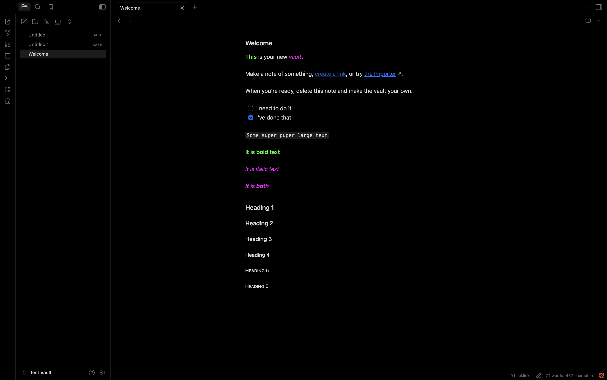

# Black Blue

A true-black dark theme with a vivid blue accent, built on the macOS color scheme.

## Settings

| Setting | Value |
|---------|-------|
| Appearance → Accent color | `#0077FF` |
| Minimal Theme Settings → Color scheme | macOS |
| Minimal Theme Settings → Contrast | True Black |

## Preview

## Installation

1. Follow the general [installation steps](../../README.md#installation)
2. Apply the settings from the table above
