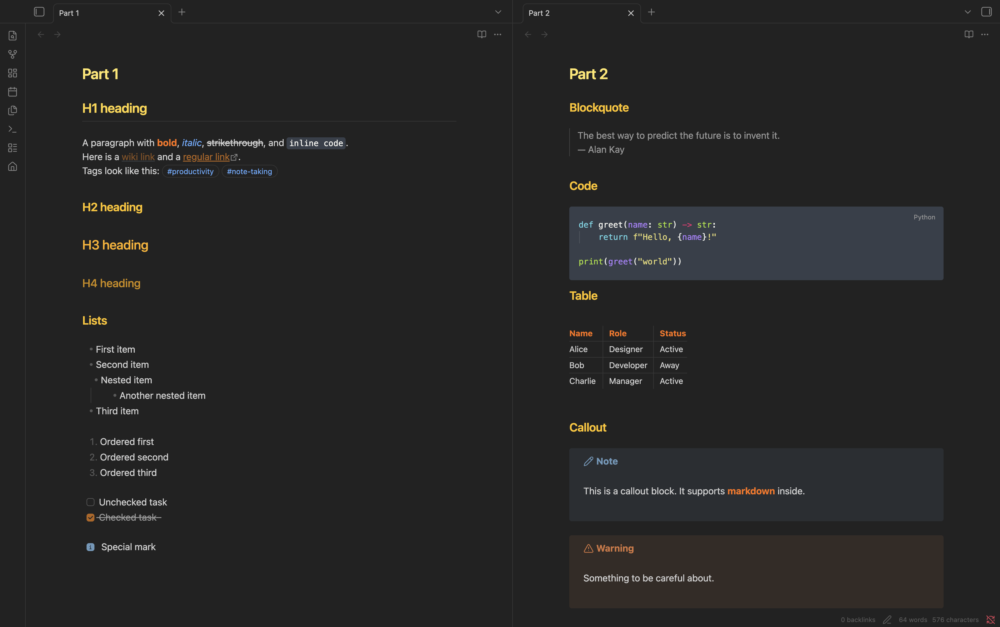

# Dark Amber

A dark theme with warm amber headings and Monokai-style code highlighting, built on the GitHub dark dimmed color palette.

## Settings

All Minimal Theme Settings options are left at their defaults.

## Preview

## Installation

1. Follow the general [installation steps](../../README.md#installation)
2. Import `style-settings.json` via the Style Settings plugin
