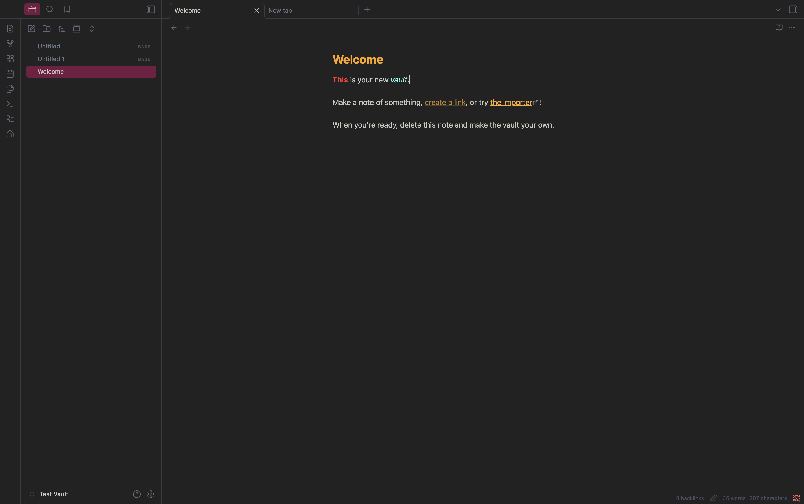

# Dark Pink

A dark theme with a vibrant pink accent, built on the Ayu color scheme.

## Settings

| Setting | Value |
|---------|-------|
| Appearance → Accent color | `#FF50A5` |
| Minimal Theme Settings → Color scheme | Ayu |

## Preview

## Installation

1. Follow the general [installation steps](../../README.md#installation)
2. Apply the settings from the table above
