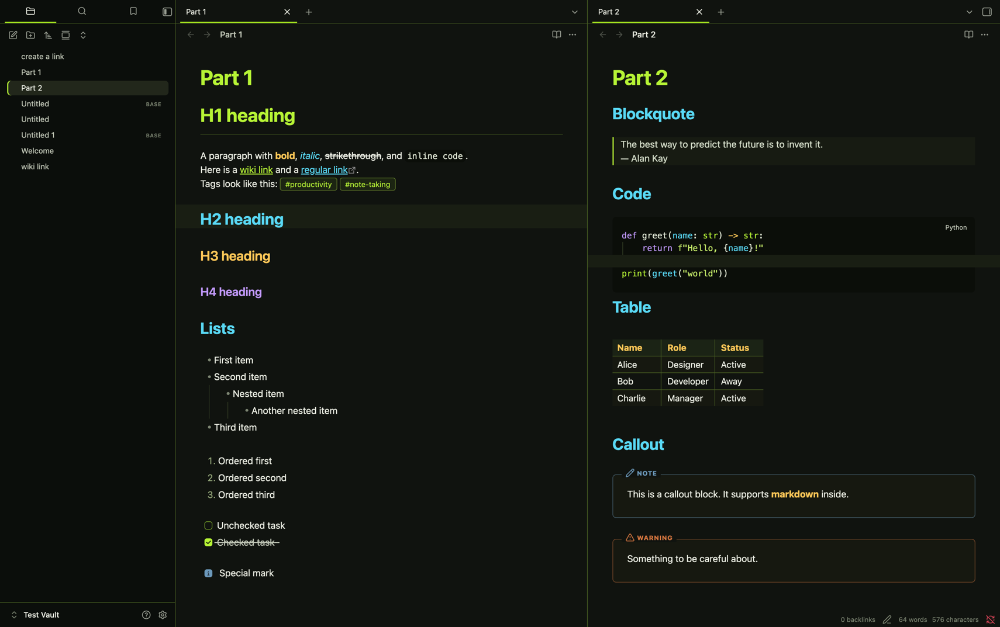

# Midnight Lime

A dark theme with vivid lime accents, olive backgrounds, and colorful headings.

## Settings

Use dark mode. All Minimal Theme Settings options are left at their defaults.

## Preview

## Installation

1. Install **Minimal Theme** in Obsidian (Settings → Appearance → Themes) and select dark mode
2. Install **Style Settings**, open its settings, and import the contents of [`style-settings.json`](style-settings.json)
3. Copy [`midnight-lime.css`](midnight-lime.css) to your vault's `.obsidian/snippets/` folder, then enable **midnight-lime** under Settings → Appearance → CSS snippets
